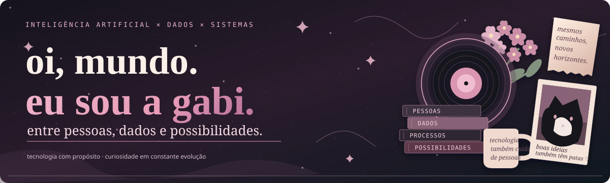

  

  
<strong>Psicologia × Inteligência Artificial × Ciência de Dados</strong>

  
<em>Curiosidade, pessoas e tecnologia com propósito.</em>

### ✦ sobre mim

Sou **Gabriela Correia**, psicóloga e estudante de **Inteligência Artificial e Ciência de Dados no IFMT**. Gosto de conectar diferentes áreas para transformar ideias em soluções úteis, mais humanas e bem organizadas.

Meu foco está no encontro entre **pessoas, educação, dados e tecnologia** — especialmente na automação de processos, na organização de informações e no desenvolvimento de ferramentas para facilitar o trabalho das equipes.

Fora das telas: música indie, boas histórias e meus gatos. 🎧 🐈

### ✦ o que estou explorando

| 🧠 Pessoas e comportamento | 📊 Dados e análise | ⚙️ Sistemas e automação |
| :--- | :--- | :--- |
| Psicologia organizacional, experiência e desenvolvimento humano. | Organização, exploração e interpretação de dados. | Ferramentas, fluxos e interfaces com foco em uso real. |

### ✦ tecnologias & ferramentas

**Ferramentas que uso e estudo**, sem ranking de proficiência:

`Python` · `JavaScript` · `HTML` · `CSS` · `Google Apps Script` · `Google Sheets` · `Git` · `GitHub`

### ✦ projetos & experimentos

> Meu portfólio público está sendo organizado. Por enquanto, estes são **temas de interesse**, e não links para sistemas ou repositórios privados.

| ✧ Sistemas de processos | ✧ Dados para decisões | ✧ Automação com propósito |
| :--- | :--- | :--- |
| Experiências de organização e melhoria de fluxos de trabalho. | Estudos e análises para transformar dados em informação útil. | Experimentos com ferramentas e rotinas mais simples, seguras e humanas. |

### ✦ em construção

- [x] Identidade visual do perfil: **Indie Tech**
- [x] Estrutura inicial do README
- [ ] Selecionar projetos que podem ser apresentados publicamente
- [ ] Adicionar demonstrações e documentação sem dados sensíveis
- [ ] Incluir métricas reais, caso façam sentido
- [ ] Definir links profissionais que desejo divulgar

  
🎶 um pouco além do código

   
  Gosto de pensar que um bom projeto também tem ritmo: algumas ideias começam como rascunhos, outras levam tempo para ganhar forma. A música, a criatividade e a curiosidade fazem parte desse processo.

 

  

