  <picture>
    <source media="(prefers-color-scheme: dark)" srcset="assets/dark/banner.svg" />
    
  </picture>

 

### ✦ sobre mim

Sou **Gabriela Correia**, psicóloga de formação e estudante de **Inteligência Artificial e Ciência de Dados no IFMT**. Trabalho no encontro entre **pessoas, dados e código**: entender como as pessoas trabalham e decidem, e construir ferramentas que deixem esse caminho mais simples.

Gosto de transformar processos confusos em fluxos claros, planilhas em sistemas e dados em decisões, sem perder de vista quem está do outro lado da tela.

> pessoas × dados × impacto real

### ✦ áreas de interesse

<picture>
  <source media="(prefers-color-scheme: dark)" srcset="assets/dark/areas.svg" />
  
</picture>

### ✦ tecnologias & ferramentas

<picture>
  <source media="(prefers-color-scheme: dark)" srcset="assets/dark/stack.svg" />
  
</picture>

Ferramentas que uso, exploro e sigo aprendendo, em diferentes níveis de experiência.

### ✦ o que eu construo

*Estes cards mostram **áreas de trabalho e estudo**, não repositórios públicos. Os projetos que puderem ser divulgados aparecerão aqui.*

<table>
  <tr>
    <td width="50%" valign="top">
      <picture>
        <source media="(prefers-color-scheme: dark)" srcset="assets/dark/cards/sistemas.svg" />
        
      </picture>
      Aplicações para organizar informações, processos e fluxos operacionais.
    </td>
    <td width="50%" valign="top">
      <picture>
        <source media="(prefers-color-scheme: dark)" srcset="assets/dark/cards/dados.svg" />
        
      </picture>
      Explorar e interpretar dados para apoiar decisões.
    </td>
  </tr>
  <tr>
    <td width="50%" valign="top">
      <picture>
        <source media="(prefers-color-scheme: dark)" srcset="assets/dark/cards/automacao.svg" />
        
      </picture>
      Rotinas que reduzem tarefas repetitivas e conectam ferramentas.
    </td>
    <td width="50%" valign="top">
      <picture>
        <source media="(prefers-color-scheme: dark)" srcset="assets/dark/cards/pessoas.svg" />
        
      </picture>
      Tecnologia pensada a partir de quem usa: educação, usabilidade e comportamento.
    </td>
  </tr>
</table>

### ✦ explorando agora

- **IA aplicada:** novas ferramentas e possibilidades de automação.
- **Ciência de Dados:** programação, exploração e interpretação de dados.
- **Desenvolvimento:** interfaces, arquitetura e boas práticas.
- **Tecnologia para pessoas:** usabilidade, educação e uso responsável da IA.

### ♫ on repeat

<picture>
  <source media="(prefers-color-scheme: dark)" srcset="assets/dark/musica.svg" />
  
</picture>

Card ilustrativo, sem player. A playlist pública entra aqui depois.

 

  <picture>
    <source media="(prefers-color-scheme: dark)" srcset="assets/dark/footer.svg" />
    
  </picture>
   
  feito com curiosidade e criatividade ♡

