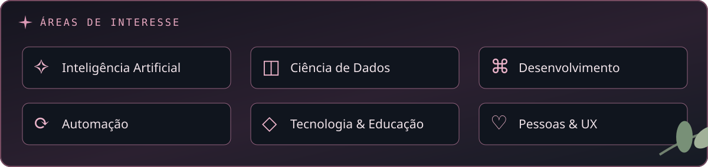
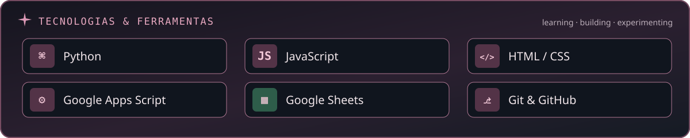
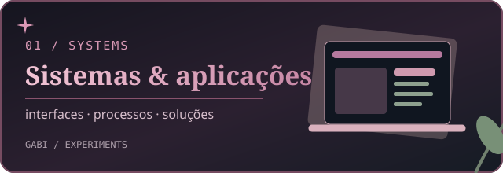
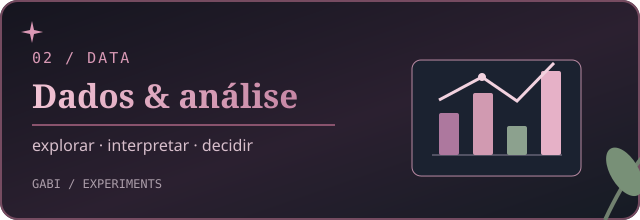
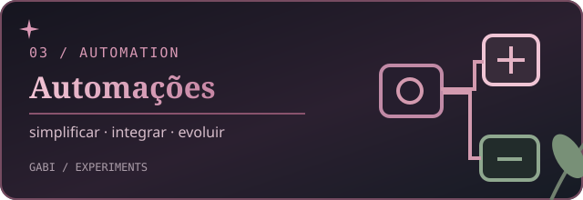
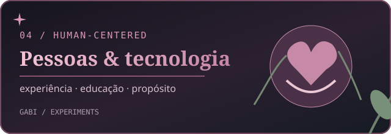

  
   
   
  <strong>Inteligência Artificial × Ciência de Dados × Desenvolvimento de Sistemas</strong>
   
  <em>tecnologia com propósito. curiosidade em constante evolução.</em>

 

### ✦ sobre mim

Sou **Gabriela Correia**, estudante de **Inteligência Artificial e Ciência de Dados no IFMT** e psicóloga de formação. Minha trajetória conecta **programação, dados, automação e comportamento humano**.

Gosto de compreender problemas, explorar possibilidades e construir ferramentas que tornem processos mais inteligentes, organizados e eficientes. Minha experiência na área da educação e em Psicologia contribui para uma visão interdisciplinar sobre o desenvolvimento de soluções digitais.

> pessoas × dados × impacto real

### ✦ áreas de interesse

Exploro especialmente a aplicação de IA e dados em **sistemas**, a melhoria de **fluxos de trabalho** e a criação de tecnologias mais acessíveis e úteis para as pessoas.

### ✦ tecnologias & ferramentas

Ferramentas que utilizo, exploro e continuo aprendendo, em diferentes níveis de experiência.

### ✦ projetos & experimentos

*Estes cards representam **áreas de trabalho e estudo**, não repositórios públicos ou produtos disponíveis. Os projetos que puderem ser divulgados serão documentados aqui futuramente.*

<table>
  <tr>
    <td width="50%" valign="top">
      
       <strong>01 / Sistemas & aplicações</strong> 
      Desenvolvimento e experimentação de aplicações para organizar informações, processos e fluxos operacionais.
       Desenvolvimento · Interfaces · Sistemas
    </td>
    <td width="50%" valign="top">
      
       <strong>02 / Dados & análise</strong> 
      Exploração e interpretação de dados para transformar informações em conhecimento útil e apoiar decisões.
       Python · Indicadores · Análise de Dados
    </td>
  </tr>
  <tr>
    <td width="50%" valign="top">
      
       <strong>03 / Automações</strong> 
      Ferramentas e rotinas que reduzem tarefas repetitivas, conectam recursos digitais e simplificam o trabalho.
       JavaScript · Apps Script · Automação
    </td>
    <td width="50%" valign="top">
      
       <strong>04 / Pessoas & tecnologia</strong> 
      Estudos e soluções que aproximam desenvolvimento tecnológico, educação, usabilidade e comportamento humano.
       Experiência do Usuário · Psicologia · Tecnologia
    </td>
  </tr>
</table>

### ✦ currently exploring

- **IA aplicada:** ferramentas e novas possibilidades de automação.
- **Ciência de Dados:** programação, exploração e interpretação de informações.
- **Desenvolvimento:** interfaces, arquitetura e boas práticas.
- **Tecnologia para pessoas:** usabilidade, educação e uso responsável da IA.

*sempre aprendendo, sempre criando. ♡*

### ♫ on repeat

Minha playlist pública do Spotify será adicionada aqui depois. O card é ilustrativo e não possui controles de reprodução.

### ✦ contribuições & evolução

A atividade e as contribuições **reais** podem ser acompanhadas nas seções nativas do meu perfil no GitHub. Sem contadores ou estatísticas fictícias por aqui.

 

  
   
  feito com curiosidade, criatividade. ♡

